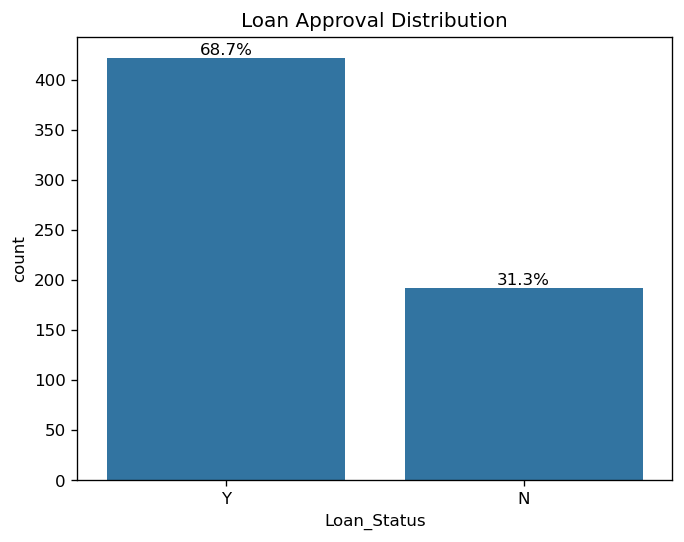
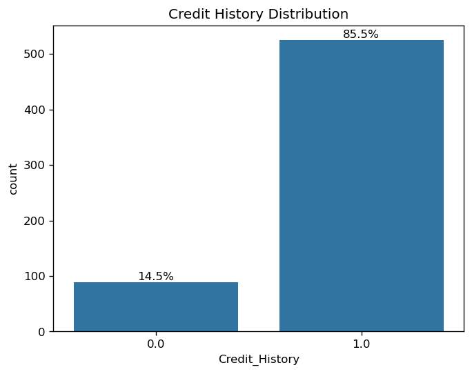
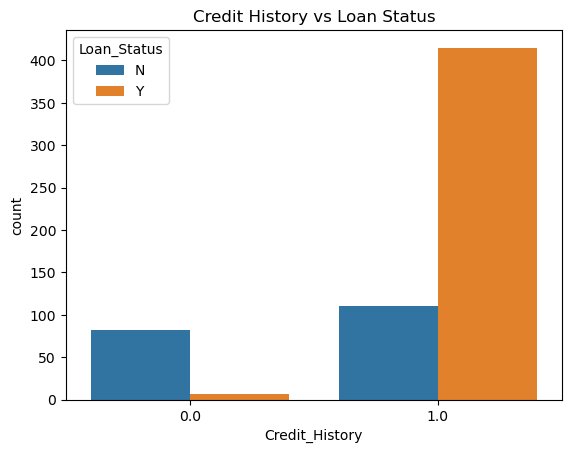
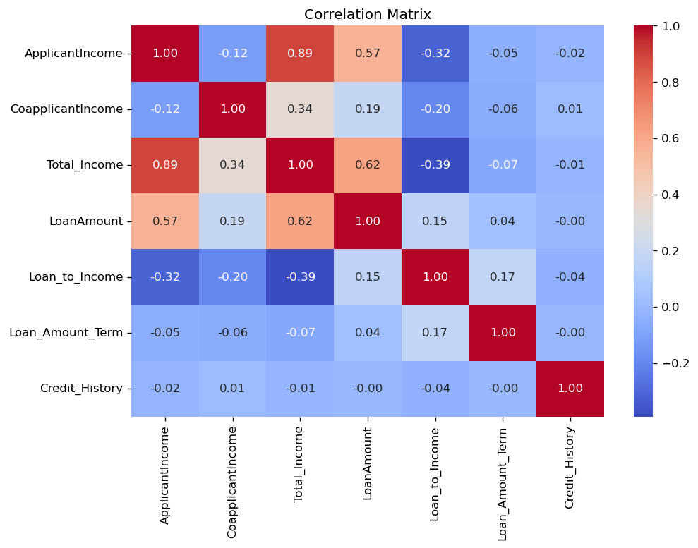

# Loan Approval EDA & Statistical Analysis

## Key Finding

**Credit history is the dominant factor associated with loan approval in this dataset.** Applicants with a recorded positive credit history were approved about 79% of the time, versus about 8% for those without one. On the 564 rows with a recorded credit history, that is 378 of 475 (79.6%) versus 7 of 89 (7.9%). A chi-square test confirms the association (χ² = 176.1, p < 0.0001), and a joint logistic regression agrees: holding the other variables constant, the odds of approval are about **39.5 times higher** with a positive credit history.

**How to read that number.** An odds ratio compares odds, not probabilities, so it is not “39.5 times more likely.” The raw, unadjusted odds ratio is about 45.6 (95% CI 20–102), while the probability of approval is about 10 times higher (79.6% vs 7.9%). The interval is wide because only 7 applicants without a credit history were approved, so the exact size of the odds ratio is uncertain even though the direction and strength of the effect are not.

An earlier pass of this project reported this odds ratio as about 3.4. That number came from fitting the model with `Credit_History` standardized (`StandardScaler`) alongside continuous features, which re-expresses its coefficient in “per 1 standard deviation” units instead of “0 vs 1.” For a binary variable with SD ≈ 0.35, those are very different sizes. Leaving binary and dummy columns unscaled did not change the conclusion; it corrected the number by more than 10x (about 3.4 to 39.5).

**Raw income and loan amount show no statistically significant relationship with approval**, either alone (all p > 0.4) or jointly in the model (all p > 0.17).

A repeated cross-validated baseline model beats the 69.1% majority-class baseline modestly: accuracy 72.6% and ROC-AUC 0.714, averaged over 50 folds (see the interval caveat under Model Performance). This is more conservative than the single-split result (79.7% accuracy, 0.864 AUC), which was an optimistic draw.

---

## Problem Statement

Financial institutions must evaluate loan applications while balancing risk against missed business. This project uses hypothesis testing, not just visualization, to identify which applicant factors are actually associated with approval, and which only *look* associated on a chart.

**Important scope note:** the target `Loan_Status` records the lender’s *approval decision*, not whether the borrower later repaid. Findings therefore describe how approval decisions relate to applicant attributes. They do not show which applicants are riskier borrowers.

---

## Dataset Overview

* **Source:** Kaggle (Loan Prediction Dataset)
* **Size:** 614 rows, 13 columns (including `Loan_ID` and the target)
* **Target:** `Loan_Status` (Y/N) — **68.7% approved / 31.3% rejected.** This imbalance matters: any classifier built on this data needs to beat a 68.7% “approve everyone” baseline to demonstrate real value.

---

## Data Cleaning & Preprocessing

Two separate cleaning passes exist in this project, deliberately:

* **EDA-level cleaning** (mode for categorical, median for numeric) uses statistics from the full 614-row dataset — standard for descriptive EDA, since there is no train/test split at that stage.
* **Modeling-level cleaning** fits imputation values (mode/median) on the training set only, *after* splitting. The earlier version of this project computed imputation on the full dataset before splitting, which leaks test-set information into training rows. Fixed by reordering the pipeline: split first, then impute.

Also: `Dependents` `"3+"` → `3`; `Loan_ID` dropped (identifier, non-predictive); `Total_Income` and `Loan_to_Income` engineered post-imputation, separately for train and test.

Before imputing `Credit_History` (8.1% missing, 50 rows), I checked whether missingness itself correlates with approval. The missing group was approved 74.0% of the time, close to the overall rate and far from the 7.9% of the no-history group, so it does not behave like an automatic-reject group and mode imputation is a reasonable simplification. Approval rates quoted from the EDA are computed after this imputation; rates on non-missing rows only are given in Key Finding.

---

## Exploratory Data Analysis

### Univariate

Loan approval distribution:



Credit history distribution:



### Bivariate

Credit history vs loan approval:



Dependents vs loan approval. Approval rates across 0/1/2/3 dependents (68.6% / 64.7% / 75.3% / 64.7%) show no clean pattern, and a chi-square test finds no significant association (p = 0.37). An earlier version of this README claimed that applicants with no dependents have higher approval rates; that claim did not survive testing and was dropped.


Property area vs loan approval (Semiurban 76.8% > Urban 65.8% > Rural 61.5%):


Education vs loan approval (nominally significant at p = 0.043, but this does not survive multiple-comparison correction; see below):


### Multivariate

Correlation between numerical features:



### Outliers (IQR method)

* `ApplicantIncome`: 50 outliers (8.1%), max 81,000 vs. an IQR upper bound of about 10,171
* `LoanAmount`: 41 outliers (6.7%) when computed after median imputation of the 22 missing values, with an upper bound of about 262. Computed on the 592 non-missing values only, it is 39 outliers with an upper bound of 270. The counts differ because filling with one repeated value compresses the quartiles.

Checking the large loans against income showed they come with larger incomes (median combined income about 15,100 vs about 5,400 overall) and a similar loan-to-income ratio, so they look like real applicants, not data-entry errors, and were kept.

---

## Method

* **Categorical variables vs. `Loan_Status`:** chi-square test of independence, which compares observed counts with the counts expected if there were no relationship
* **Numeric variables vs. `Loan_Status`:** point-biserial correlation
* **Multiple comparisons:** 13 hypothesis tests were run in total, corrected with Bonferroni (α = 0.05 / 13 ≈ 0.0038) rather than reading each p-value against the uncorrected 0.05 threshold

---

## Statistical Findings

| Variable | Test | Statistic | p-value | Sig. (p<0.05) | Sig. (Bonferroni) |
|---|---|---|---|---|---|
| Credit_History | χ² | 176.11 | <0.0001 | ✅ | ✅ |
| Property_Area | χ² | 12.30 | 0.0021 | ✅ | ✅ |
| Married | χ² | 4.73 | 0.0296 | ✅ | ❌ |
| Loan_to_Income | point-biserial r | -0.086 | 0.0328 | ✅ | ❌ |
| Education | χ² | 4.09 | 0.0431 | ✅ | ❌ |
| CoapplicantIncome | point-biserial r | -0.059 | 0.1429 | ❌ | ❌ |
| Dependents | χ² | 3.15 | 0.3689 | ❌ | ❌ |
| LoanAmount | point-biserial r | -0.033 | 0.4113 | ❌ | ❌ |
| Total_Income | point-biserial r | -0.031 | 0.4392 | ❌ | ❌ |
| Loan_Amount_Term | point-biserial r | — | 0.5771 | ❌ | ❌ |
| Gender | χ² | 0.11 | 0.7391 | ❌ | ❌ |
| ApplicantIncome | point-biserial r | -0.005 | 0.9073 | ❌ | ❌ |
| Self_Employed | χ² | 0.00 | 1.0000 | ❌ | ❌ |

**Only `Credit_History` and `Property_Area` survive Bonferroni correction.** With 13 tests at an uncorrected α of 0.05, about 0.65 false positives are expected from chance alone, and `Married` and `Education` sit where that predicts. The honest framing is that this dataset cannot distinguish them from noise; they would need re-testing on a larger or independent sample.

**Small-cell caution.** Of the 89 applicants with a recorded “no history” value, only 7 were approved. Within property areas that is 2, 4 and 1 approvals, so differences between areas *within* the no-history group rest on a handful of people and should not be interpreted.

---

## Baseline Model — Validating the EDA Jointly

A logistic regression checks whether `Credit_History` still dominates once every variable is controlled for simultaneously, and whether the model’s own significance tests agree with the corrected EDA findings.

**Pipeline (leakage-aware):** categorical labels encoded before splitting (deterministic, not a statistical fit); train/test split; imputation (mode/median) fit on training data only and applied to both sets; feature engineering and log-transforms applied post-imputation to each set independently; `StandardScaler` fit on training data and applied **only to continuous columns** — `Credit_History`, `Gender`, `Married`, `Education`, `Self_Employed`, `Dependents`, and the `Property_Area` dummies stay on their natural 0/1 scale so coefficients are directly interpretable.

*Caveat:* imputation and scaling were fit on the full training split before cross-validation, so inside each fold the validation rows influenced those fits. The effect is expected to be small but was not measured. See Future Scope.

**Statistical inference:** fit with `statsmodels.Logit` (not just scikit-learn) to get standard errors and p-values per coefficient, which is necessary to say the model “agrees” with the EDA rather than just “points the same direction.” The model was fit on the 80% training split (491 rows).

### Coefficients (statsmodels)

| Feature | Odds Ratio | p-value | Significant? |
|---|---|---|---|
| **Credit_History** | **39.51** | <0.0001 | ✅ |
| Property_Area_Semiurban | 2.23 | 0.0062 | ✅ |
| Married | 1.55 | 0.124 | ❌ |
| Education | 1.43 | 0.202 | ❌ |
| CoapplicantIncome | 1.28 | 0.171 | ❌ |
| Gender | 0.79 | 0.468 | ❌ |
| Self_Employed | 0.82 | 0.570 | ❌ |
| LoanAmount | 0.83 | 0.379 | ❌ |
| ApplicantIncome | 1.18 | 0.471 | ❌ |
| Property_Area_Urban | 1.18 | 0.565 | ❌ |
| Dependents | 1.12 | 0.381 | ❌ |
| Loan_to_Income | 1.04 | 0.824 | ❌ |
| Loan_Amount_Term | 1.02 | 0.881 | ❌ |

Each odds ratio is the multiplicative change in the *odds* of approval for a one-unit change, holding the other variables constant. Continuous features were standardized, so their odds ratios are per one standard deviation.

**The same two variables, `Credit_History` and `Property_Area`, are significant in the joint model and survive Bonferroni correction in the univariate tests.** The two analyses use the same data, so this is a consistency check rather than independent confirmation. `Married` and `Education` are non-significant in the model too, consistent with failing correction above. The confidence interval around the credit-history odds ratio is wide (see Key Finding); the interval from the fitted model should be read alongside the point estimate.

### Model Performance (repeated cross-validation)

| Metric | Majority Baseline | Single 80/20 Split | Repeated CV (5-fold × 10) — report this |
|---|---|---|---|
| Accuracy | 69.1% | 79.7% | **72.6%** |
| ROC-AUC | — | 0.864 | **0.714** |

The single split is optimistic. Repeating 5-fold cross-validation 10 times gives 50 estimates instead of one lucky or unlucky draw. The 50 folds reuse the same rows, so they are not independent: an interval computed from their spread (for example 72.6%, 95% CI [71.5%, 73.7%]) is too narrow and should be read as a lower bound on the true uncertainty.

Test-set classification report (single split, for reference):

| Class | Precision | Recall | F1 |
|---|---|---|---|
| Rejected | 0.68 | 0.66 | 0.67 |
| Approved | 0.85 | 0.86 | 0.85 |

Recall on `Rejected` is the weaker of the two classes here, worth flagging rather than burying under overall accuracy.

---

## Scope of the Findings

Income does not predict approval *in this dataset*, which is a defensible, tested claim. It is not, on its own, evidence about how real underwriting should be designed. This is a 614-row Kaggle convenience sample with no documented sampling process (unknown institution, market, year, or stage of underwriting), and the target is an approval decision, not a repayment outcome. Whether “credit history matters more than income” generalizes is a hypothesis for provenance-known data, not a policy recommendation this project can support.

---

## Takeaways

*(Scoped to this dataset, not stated as generalizable policy.)*

* Within this dataset, `Credit_History` is the only large, robust signal. Everything else is either non-significant or fails correction for multiple testing.
* `Property_Area` (Semiurban) is the only other variable that holds up under both corrected testing and joint modeling. It is worth investigating *why* before treating it as causal.
* Income thresholds carry no independent signal here once credit history is known. This is a within-dataset finding, not a transferable underwriting rule.
* Before building any model on this data, address the 69/31 class imbalance and decide how to handle the income and loan-amount outliers.

---

## Limitations

* n = 614 is a small, well-worn benchmark dataset with unknown sampling provenance. Findings demonstrate methodology, not production-ready policy.
* The target is an approval decision, not default or repayment, so nothing here measures credit risk directly.
* `Credit_History` is missing for 50 rows. The check on those rows is informative but the sample is small.
* `Married` and `Education` fail multiple-comparisons correction but are not dismissed entirely; a larger sample could still find a real, smaller effect.
* The no-history group is small (89 applicants, 7 approvals), so the credit-history odds ratio has a wide confidence interval.
* The baseline model is linear (logistic regression) and cannot capture interaction effects a tree-based model might find.
* The cross-validation interval understates uncertainty because folds overlap, and imputation and scaling are fit before cross-validation.

---

## Future Scope

* Wrap imputation, scaling and the model in a scikit-learn `Pipeline` so they are re-fit inside every cross-validation fold, and report an interval that accounts for fold dependence.
* Report the confidence interval of the credit-history odds ratio from the fitted model alongside the point estimate.
* Compare against tree-based models (Random Forest, Gradient Boosting) to check for interaction effects.
* Threshold tuning, since the default 0.5 cutoff is not necessarily optimal.
* If a non-linear model is adopted, add SHAP or permutation importance.

---

## Tools & Technologies

Python · Pandas · NumPy · Matplotlib · Seaborn · SciPy (`chi2_contingency`, `pointbiserialr`) · Statsmodels (`Logit`) · Scikit-learn (`LogisticRegression`, `RepeatedStratifiedKFold`)

---

## Project Structure

```bash
loan-risk-eda-analysis/
│
├── data/
│   └── train.csv
├── notebooks/
│   └── loan_eda.ipynb
├── images/
│   └── (visualizations)
└── README.md
```

---

## Author

**Mohammad Adil**
Data Analyst | Risk & Business Analytics
